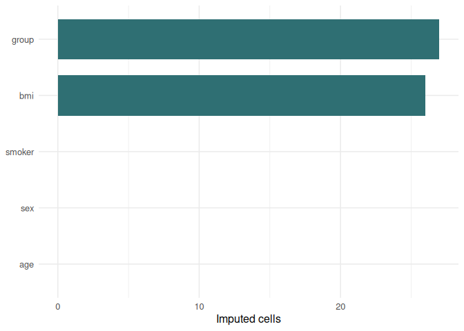
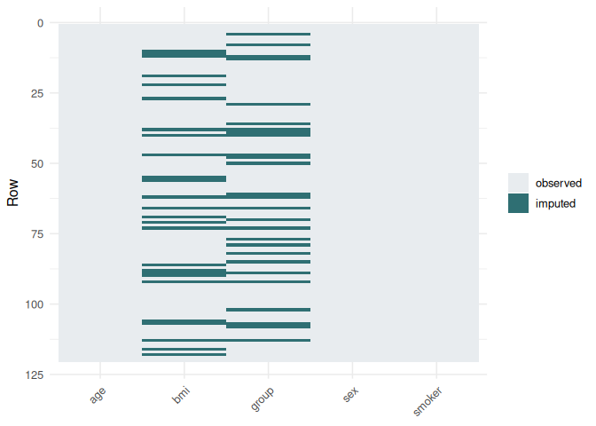
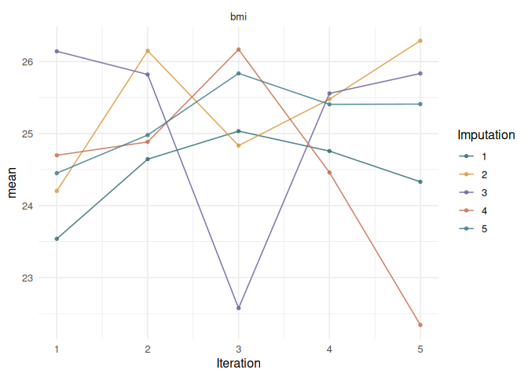
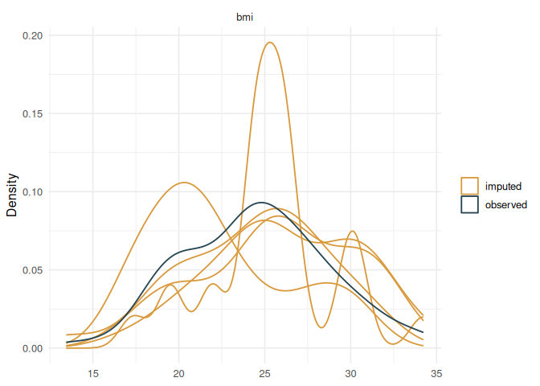
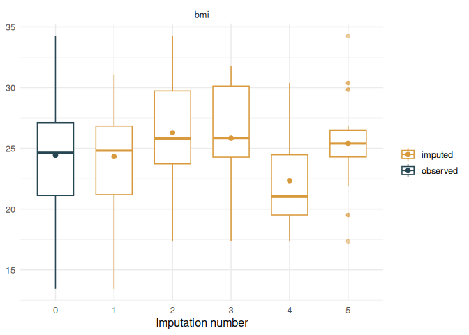
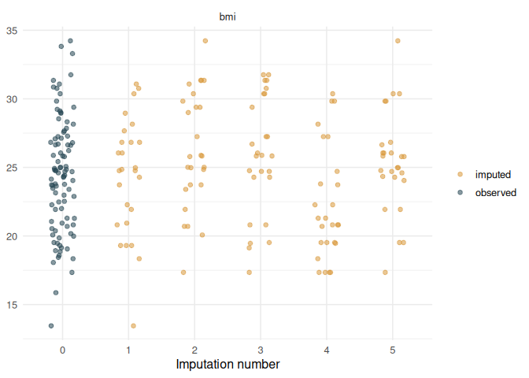
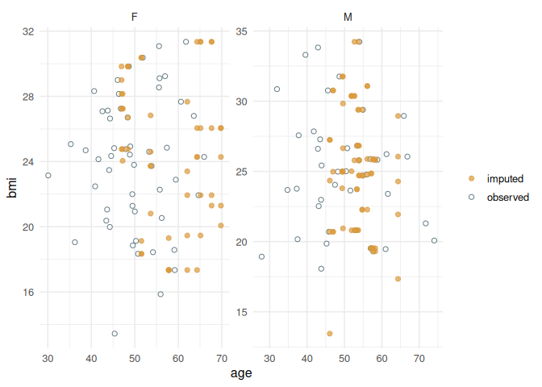
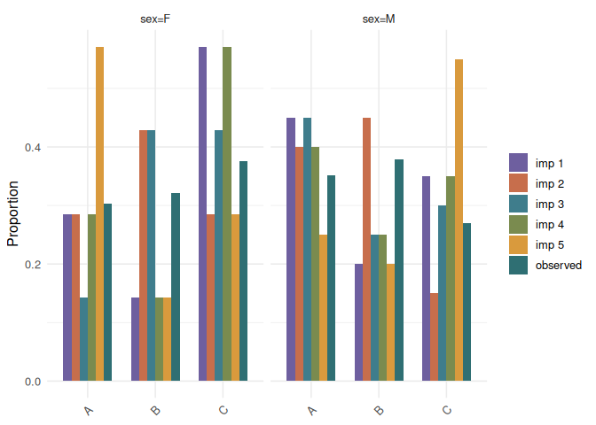

# mimar

[](https://CRAN.R-project.org/package=mimar)

`mimar` implements a compact chained-imputation workflow in R for
missing-data analysis, artificial amputation, native and learner-backed
single and multiple imputation, diagnostic evaluation, and
post-imputation pooling.

The package is built around a complete missing-data workflow: describe
the missingness, create benchmark amputations when needed, impute with
native or learner-backed update rules, inspect diagnostics, evaluate
recovered cells when truth is available, and pool post-fit quantities.
The goal is a concise grammar for the whole workflow, not a replacement
for every specialist feature in larger imputation systems.

The package owns the imputation loop. Every imputer, whether implemented
natively or backed by a learner package, is called the same way:

``` r
impute(data, imputer = "pmm", m = 5, maxit = 5, seed = 1)
impute(data, imputer = "rf", m = 5, seed = 1)
impute(data, imputer = "xgboost", m = 5, seed = 1)
```

There is no dependency on `funcml`. Learner-backed imputers call their
original packages directly, and those backend packages are hard
dependencies so users can run any registered imputer without manually
resolving learner installations.

## Installation

Install the released version from CRAN:

``` r
install.packages("mimar")
```

The CRAN package page is <https://CRAN.R-project.org/package=mimar>.

You can install the development version from GitHub:

``` r
install.packages("remotes")
remotes::install_github("ielbadisy/mimar")
```

Then load the package:

``` r
library(mimar)
```

## Quick use

For normal use, `impute()` is the only function you need. The input data
can contain `NA`, and the completed outputs returned by `complete()` do
not. Set `verbose = TRUE` when you want a concise progress log for the
chained imputation workflow.

Tabular results (`describe()`, `complete()`, `evaluate()`, `pool()`,
`imputerregistry()`) are returned as `basetable` objects, which behave
like data frames.

``` r
i <- impute(a, imputer = "knn", m = 5, maxit = 5, seed = 1)
complete(i, 1)
complete(i, "all")
```

## Grammar

``` r
describe()
ampute()
imputerregistry()
imputer()
impute()
complete()
evaluate()
pool()
poollm(), poolglm(), poolcoxph(), poolsurvreg(), poolclogit(), poolpanglm()
pooltest()
nelsonaalen(), ipcw()
plot()
```

## Short example

``` r

library(mimar)

set.seed(1)
dat <- data.frame(
  age = rnorm(120, 50, 10),
  bmi = rnorm(120, 25, 4),
  sex = factor(sample(c("F", "M"), 120, TRUE)),
  group = factor(sample(c("A", "B", "C"), 120, TRUE)),
  smoker = sample(c(TRUE, FALSE), 120, TRUE)
)

a <- ampute(
  dat,
  prop = 0.25,
  mechanism = "MAR",
  target = c("bmi", "group"),
  by = c("age", "sex"),
  seed = 1
)

i <- impute(a, imputer = "knn", m = 5, maxit = 5, seed = 1, ncore = 2)
complete(i, 1)
#> # basetable: 120 x 5
#>         age      bmi sex group smoker
#> 1  43.73546 22.97617   M     C  FALSE
#> 2  51.83643 30.37216   F     A  FALSE
#> 3  41.64371 24.14168   F     B   TRUE
#> 4  65.95281 24.28177   F     C   TRUE
#> 5  53.29508 24.59924   F     A  FALSE
#> 6  41.79532 27.85067   M     C   TRUE
#> 7  54.87429 24.70574   M     B   TRUE
#> 8  57.38325 24.84946   F     B  FALSE
#> 9  55.75781 22.27336   F     B  FALSE
#> 10 46.94612 30.76463   M     A  FALSE
#> # 110 more rows
summary(i)
#> mimar imputation summary
#> # basetable: 1 x 11
#>   rows columns n_imputations imputer maxit ncore stochastic
#> 1  120       5             5     knn     5     2       TRUE
#>   total_missing_before total_imputed remaining_missing variables_imputed
#> 1                   53            53                 0                 2
#> 
#> Variables:
#> # basetable: 5 x 9
#>   variable    type method n_missing_before prop_missing_before n_imputed
#> 1      age numeric   none                0           0.0000000         0
#> 2      bmi numeric    knn               26           0.2166667        26
#> 3      sex  factor   none                0           0.0000000         0
#> 4    group  factor    knn               27           0.2250000        27
#> 5   smoker logical   none                0           0.0000000         0
#>   prop_imputed remaining_missing between_imputation_sd
#> 1            0                 0              0.000000
#> 2            1                 0              0.341076
#> 3            0                 0              0.000000
#> 4            1                 0              0.000000
#> 5            0                 0              0.000000
evaluate(i)
#> mimar imputation evaluation
#> # basetable: 1 x 4
#>   n_imputations imputer total_missing evaluated_cells
#> 1             5     knn            53              53
plot(i, type = "density")
```


## Imputers

Inspect available imputers with:

``` r
imputerregistry()
#> # basetable: 25 x 10
#>    imputer implementation  package supports_numeric supports_binary
#> 1     mean          mimar internal             TRUE            TRUE
#> 2   median          mimar internal             TRUE            TRUE
#> 3     mode          mimar internal             TRUE            TRUE
#> 4    naive          mimar internal             TRUE            TRUE
#> 5     norm          mimar internal             TRUE            TRUE
#> 6      pmm          mimar internal             TRUE            TRUE
#> 7     spmm          mimar internal             TRUE            TRUE
#> 8   logreg          mimar internal             TRUE            TRUE
#> 9  polyreg          mimar internal             TRUE            TRUE
#> 10      rf        wrapped   ranger             TRUE            TRUE
#>    supports_multiclass stochastic
#> 1                 TRUE      FALSE
#> 2                 TRUE      FALSE
#> 3                 TRUE      FALSE
#> 4                 TRUE      FALSE
#> 5                 TRUE       TRUE
#> 6                 TRUE       TRUE
#> 7                 TRUE       TRUE
#> 8                 TRUE       TRUE
#> 9                 TRUE       TRUE
#> 10                TRUE       TRUE
#>                                         description available    status
#> 1               Mean imputation for numeric targets      TRUE available
#> 2             Median imputation for numeric targets      TRUE available
#> 3           Mode imputation for categorical targets      TRUE available
#> 4                      Median/mode chained baseline      TRUE available
#> 5         Bayesian linear regression posterior draw      TRUE available
#> 6                          Predictive mean matching      TRUE available
#> 7              Single-step predictive mean matching      TRUE available
#> 8                   Binary logistic regression draw      TRUE available
#> 9  One-vs-rest multinomial logistic regression draw      TRUE available
#> 10           MissForest-style random forest imputer      TRUE available
#> # 15 more rows
describe("imputers")
#> mimar available imputers
#> # basetable: 25 x 10
#>    imputer implementation  package supports_numeric supports_binary
#> 1     mean          mimar internal             TRUE            TRUE
#> 2   median          mimar internal             TRUE            TRUE
#> 3     mode          mimar internal             TRUE            TRUE
#> 4    naive          mimar internal             TRUE            TRUE
#> 5     norm          mimar internal             TRUE            TRUE
#> 6      pmm          mimar internal             TRUE            TRUE
#> 7     spmm          mimar internal             TRUE            TRUE
#> 8   logreg          mimar internal             TRUE            TRUE
#> 9  polyreg          mimar internal             TRUE            TRUE
#> 10      rf        wrapped   ranger             TRUE            TRUE
#>    supports_multiclass stochastic
#> 1                 TRUE      FALSE
#> 2                 TRUE      FALSE
#> 3                 TRUE      FALSE
#> 4                 TRUE      FALSE
#> 5                 TRUE       TRUE
#> 6                 TRUE       TRUE
#> 7                 TRUE       TRUE
#> 8                 TRUE       TRUE
#> 9                 TRUE       TRUE
#> 10                TRUE       TRUE
#>                                         description available    status
#> 1               Mean imputation for numeric targets      TRUE available
#> 2             Median imputation for numeric targets      TRUE available
#> 3           Mode imputation for categorical targets      TRUE available
#> 4                      Median/mode chained baseline      TRUE available
#> 5         Bayesian linear regression posterior draw      TRUE available
#> 6                          Predictive mean matching      TRUE available
#> 7              Single-step predictive mean matching      TRUE available
#> 8                   Binary logistic regression draw      TRUE available
#> 9  One-vs-rest multinomial logistic regression draw      TRUE available
#> 10           MissForest-style random forest imputer      TRUE available
#> # 15 more rows
```

Core native imputers:

- `mean`, `median`, `mode`
- `naive`: median/mode chained baseline
- `norm`: linear normal draw
- `pmm`, `spmm`: predictive mean matching
- `logreg`: binary logistic regression draw
- `polyreg`: one-vs-rest multinomial draw
- `knn`: nearest-neighbor donor imputation
- `hotdeck`: stochastic donor imputation

Learner-backed imputers:

- `rf`: MissForest-style chained random forest imputer through `ranger`
- `ranger`: random forest through `ranger`
- `rpart`: tree imputer through `rpart`
- `nbayes`: naive Bayes through `naivebayes`
- `svm`: support vector machine through `e1071`
- `bart`: Bayesian additive regression trees through `BART`
- `glmnet`: penalized regression through `glmnet`
- `fastgbm`: gradient boosting through `fastgbm`
- `xgboost`: gradient boosted trees through `xgboost`
- `densemlp`: dense multilayer perceptron through `densemlp`
- `famd`: FAMD-assisted donor imputation through `missMDA`
- `superlearner`, `sl`: cross-validated Super Learner-style ensemble
  imputer
- `missknn`: whole-table masked k-nearest-neighbor imputation through
  `missknn`, run in a single pass instead of the chained loop

Imputer names are strict: use the names shown by `imputerregistry()`.
Learner-backed imputers are applied as requested to numeric, binary, and
multiclass targets; `mimar` does not silently swap them for another
imputer inside benchmark runs.

## Parallel imputation

The `ncore` argument runs independent completed datasets in parallel.
The parallel boundary is the outer imputation index: each completed
dataset gets a deterministic seed offset, so a fixed `seed`, `m`,
`maxit`, and imputer remain reproducible.

``` r
i <- impute(a, imputer = "knn", m = 5, maxit = 5, seed = 1, ncore = 2)
```

Use `ncore = 1` for sequential execution, small examples, and the most
conservative behavior in constrained environments.

## Tuning imputers

Learner-backed imputers expose their hyperparameters through `imputer()`
or directly through `...` in `impute()`. Donor-based imputers use the
explicit `donors` argument.

``` r
rf_spec <- imputer("rf", num.trees = 500)
xgb_spec <- imputer("xgboost", nrounds = 100, max_depth = 3)

i1 <- impute(a, imputer = rf_spec, m = 5, maxit = 5, seed = 1)
i2 <- impute(a, imputer = "xgboost", m = 5, maxit = 5, seed = 1,
             nrounds = 100, max_depth = 3)
i3 <- impute(a, imputer = "knn", m = 5, maxit = 5, seed = 1, donors = 10)
```

The same hyperparameter set is reused across all incomplete variables
that a given imputer supports, which keeps the full chained-imputation
pipeline reproducible and easy to tune.

## Super Learner imputation

`superlearner` combines candidate imputers by cross-validating them on
observed cells, assigning non-negative loss-based weights, and using the
weighted ensemble inside the chained-imputation loop.

``` r
sl <- imputer(
  "superlearner",
  library = c("pmm", "knn", "rpart"),
  folds = 5,
  metalearner = "inverse_loss"
)

i_sl <- impute(a, imputer = sl, m = 5, maxit = 5, seed = 1)
```

The short alias `imputer = "sl"` is equivalent to
`imputer = "superlearner"`.

## Diagnostic Plots

`plot()` methods return `ggplot` objects. For `mimar_imputation`
objects, the main diagnostic types are:

``` r
plot(i)                                      # imputed cell counts
```



``` r
plot(i, type = "missing")                   # observed/imputed cell map
```



``` r
plot(i, type = "trace", statistic = "mean") # convergence-screening trace
```



``` r
plot(i, type = "density", variable = "bmi") # line-only density overlays
```



``` r
plot(i, type = "boxplot", variable = "bmi") # observed vs imputation 1:m
```



``` r
plot(i, type = "strip", variable = "bmi")   # individual values by imputation
```



Formula diagnostics are available for bivariate and categorical checks:

``` r
plot(i, type = "xy", formula = bmi ~ age | sex)
```



``` r
plot(i, type = "proportion", formula = group ~ sex)
```



For `type = "xy"`, formulas use `y ~ x` or `y ~ x | group`. For
`type = "proportion"`, formulas use `categorical_variable ~ strata`.
Density diagnostics use line-only overlays so several imputations remain
visible rather than obscuring each other with filled areas.

## Chained Imputation Model

Let `X` be an `n x p` data frame and let `R_ij = 1` when cell `(i, j)`
is missing. For each incomplete variable `X_j`:

- `O_j = {i : R_ij = 0}` are the observed rows
- `M_j = {i : R_ij = 1}` are the missing rows

At each chained update, `mimar` fits an imputer-specific model from the
observed rows and then predicts the missing rows from the current
completed data. In compact form:

``` text
fit model on X_-j, O_j -> X_j, O_j
update X_j, M_j using the fitted model
```

Multiple imputation repeats the same chained procedure `m` times with
controlled seeds, bootstrap samples of observed rows, and stochastic
prediction where supported.

Learner-backed imputers are practical stochastic update rules inside
this chained workflow. They can improve predictive recovery, but users
should still inspect trace, distribution, categorical-proportion, and
downstream sensitivity diagnostics rather than assuming every learner
automatically supplies proper multiple-imputation uncertainty for every
analysis.

## Algorithm

``` text
Input: X, R, h, m, T
Initialize: X~(0) <- init(X)
For k = 1,...,m:
  X~_k(0) <- X~(0)
  For t = 1,...,T:
    For each incomplete variable j:
      B_j <- bootstrap sample of O_j
      fit h on X~_k, B_j, -j and X_Bj,j
      update missing rows M_j using the fitted model
      restore observed rows O_j to their original values
Return: {X~_1(T), ..., X~_m(T)}
```

## Evaluation

When imputation is run on an `ampute()` object, `evaluate()` uses the
retained truth and scores only artificially removed cells. Numeric
recovery reports RMSE, MAE, bias, and correlation. Categorical recovery
reports accuracy and balanced accuracy.

## Imputation with time-to-event data

When a data set carries a follow-up time and an event indicator, the raw
survival time must not be used as a predictor for imputing other,
partially observed variables: it biases the imputation model. Following
White and Royston (2009), represent the outcome with the Nelson-Aalen
cumulative hazard plus the event indicator instead.

`nelsonaalen()` builds that predictor. With no auxiliary variables it
matches `mice::nelsonaalen()`; `aux` makes the estimate conditional,
using strata for categorical variables or a Cox model otherwise.

``` r
set.seed(1)
n <- 200
surv <- data.frame(
  x = rnorm(n),
  sex = factor(sample(c("F", "M"), n, TRUE))
)
lp <- 0.4 * surv$x + 0.3 * (surv$sex == "M")
event_time <- rexp(n, rate = exp(lp) / 8)
cens_time <- rexp(n, rate = 1 / 12)
surv$time <- pmin(event_time, cens_time)
surv$status <- as.integer(event_time <= cens_time)

surv$H0 <- nelsonaalen(surv, "time", "status")
surv$H0_bysex <- nelsonaalen(surv, time, status, aux = "sex")

surv$x[sample(n, 40)] <- NA
impute(surv[c("x", "sex", "status", "H0")], m = 5, imputer = "pmm", seed = 1)
#> mimar imputation
#> Completed datasets: 5 
#> Rows x columns: 200 x 4 
#> Imputer: pmm  maxit: 5  ncore: 1  stochastic: TRUE 
#> Missing cells imputed: 40 / 40 
#> Variables imputed: x 
#> Use complete(x) to extract completed data.
```

`ipcw()` returns subject-level inverse-probability-of-censoring weights
`Delta_i / G(T_i-)`, where `G` is the Kaplan-Meier estimate of the
censoring survivor function. Use them in weighted post-imputation
analyses. `aux` allows covariate-dependent censoring (stratified
Kaplan-Meier, or `method = "cox"`); `type = "all"` keeps a positive
weight for censored subjects, and `stabilized` and `truncate` control
the weight range.

``` r
w_event <- ipcw(surv, "time", "status")
w_all <- ipcw(surv, time, status, aux = "sex", type = "all", truncate = 0.95)
summary(w_event[w_event > 0])
#>    Min. 1st Qu.  Median    Mean 3rd Qu.    Max. 
#>   1.000   1.116   1.278   1.544   1.523  11.213
summary(w_all)
#>    Min. 1st Qu.  Median    Mean 3rd Qu.    Max. 
#>   1.000   1.111   1.317   1.580   1.680   3.982
```

The Cox-based paths use the `survival` package.

## Pooling

`pool()` combines post-fit quantities estimated separately in each
completed dataset. The statistical target is the quantity itself, not a
data frame. A quantity can be a scalar, coefficient vector,
covariance-aware parameter vector, matrix of survival probabilities, or
a scalar metric. Data frames are accepted only as a tidy adapter for
scalar model output.

For survival-probability matrices, `poolsurvmat()` applies the
complementary log-log transform internally, pools on that scale, and
back-transforms the result.

For scalar quantities with complete-data variance estimates, `pool()`
applies Rubin-style pooling:

``` text
Q_bar = mean(Q_k)
U_bar = mean(U_k)
B     = sample variance of Q_k
T     = U_bar + (1 + 1/m) * B
```

``` r
results <- data.frame(
  term = rep(c("age", "bmi"), each = 3),
  estimate = c(0.10, 0.11, 0.09, 0.30, 0.32, 0.29),
  std.error = c(0.04, 0.05, 0.04, 0.08, 0.09, 0.08),
  imputation = rep(1:3, times = 2)
)

pool(results)
#> mimar pooled results
#> # basetable: 2 x 14
#>   term  estimate  std.error statistic       df     p.value   conf.low conf.high
#> 1  age 0.1000000 0.04509250  2.217664  465.125 0.027060256 0.01138975 0.1886102
#> 2  bmi 0.3033333 0.08530989  3.555664 1094.452 0.000393134 0.13594390 0.4707228
#>   m within_variance between_variance total_variance relative_increase_variance
#> 1 3     0.001900000     0.0001000000    0.002033333                 0.07017544
#> 2 3     0.006966667     0.0002333333    0.007277778                 0.04465710
#>    rule
#> 1 rubin
#> 2 rubin
```

Direct quantity inputs are preferred when available:

``` r
pool(c(0.10, 0.11, 0.09), std.error = c(0.04, 0.05, 0.04), name = "age")
#> mimar pooled results
#> # basetable: 1 x 14
#>   term estimate std.error statistic      df    p.value   conf.low conf.high m
#> 1  age      0.1 0.0450925  2.217664 465.125 0.02706026 0.01138975 0.1886102 3
#>   within_variance between_variance total_variance relative_increase_variance
#> 1          0.0019            1e-04    0.002033333                 0.07017544
#>    rule
#> 1 rubin

betas <- list(
  c(age = 0.10, bmi = 0.30),
  c(age = 0.11, bmi = 0.32),
  c(age = 0.09, bmi = 0.29)
)
covariances <- list(
  diag(c(0.04, 0.08)^2),
  diag(c(0.05, 0.09)^2),
  diag(c(0.04, 0.08)^2)
)
pool(betas, covariance = covariances)
#> mimar pooled results
#> # basetable: 2 x 14
#>   term  estimate  std.error statistic       df     p.value   conf.low conf.high
#> 1  age 0.1000000 0.04509250  2.217664  465.125 0.027060256 0.01138975 0.1886102
#> 2  bmi 0.3033333 0.08530989  3.555664 1094.452 0.000393134 0.13594390 0.4707228
#>   m within_variance between_variance total_variance relative_increase_variance
#> 1 3     0.001900000     0.0001000000    0.002033333                 0.07017544
#> 2 3     0.006966667     0.0002333333    0.007277778                 0.04465710
#>    rule
#> 1 rubin
#> 2 rubin
```

When no reliable complete-data variance is supplied, as is common for
some performance metrics, `pool()` reports robust summaries by default:
median, interquartile range, and range across imputations.

Bounded or skewed quantities (ratios, probabilities, AUC, C-index,
correlations) are better pooled on a transformed scale. `transform`
accepts `"log"`, `"logit"`, `"cloglog"`, or `"fisherz"`; results are
reported on the original scale. `dfcom`, the complete-data degrees of
freedom, switches Rubin pooling to the Barnard and Rubin (1999)
small-sample degrees of freedom.

``` r
auc <- c(0.78, 0.81, 0.79, 0.80, 0.77)
auc_se <- c(0.030, 0.028, 0.031, 0.029, 0.032)
pool(auc, std.error = auc_se, transform = "logit", name = "AUC", dfcom = 115)
#> mimar pooled results
#> # basetable: 1 x 14
#>   term  estimate  std.error statistic      df     p.value  conf.low conf.high m
#> 1  AUC 0.7903508 0.03466437  6.343285 36.4344 2.30192e-07 0.7115515  0.852098 5
#>   within_variance between_variance total_variance relative_increase_variance
#> 1      0.03281624      0.009125116     0.04376638                  0.3336805
#>    rule
#> 1 rubin
```

## Pooling fitted models

`poollm()`, `poolglm()`, `poolcoxph()`, `poolsurvreg()`, `poolclogit()`,
and `poolpanglm()` pool a list of fitted models, one per completed
dataset, with Rubin’s rules and Barnard-Rubin degrees of freedom. They
print a coefficient table laid out like the matching `summary()` output.

``` r
d <- mtcars
d$cyl <- factor(d$cyl)
set.seed(1)
d$hp[sample(32, 6)] <- NA

imp <- impute(d, m = 5, imputer = "pmm", seed = 1)
comp <- complete(imp, "all")

fits <- lapply(comp, function(x) lm(mpg ~ cyl + hp + wt, data = x))
poollm(fits)
#> Pooled linear model
#> Pooled across m = 5 imputations (Rubin's rules)
#> 
#>             Estimate Std. Error    df t value Pr(>|t|)    
#> (Intercept) 35.96526    2.06070 24.95  17.453  1.7e-15 ***
#> cyl6        -3.19319    1.45499 23.99  -2.195 0.038110 *  
#> cyl8        -3.11061    2.17951 24.80  -1.427 0.165991    
#> hp          -0.02342    0.01192 24.46  -1.965 0.060823 .  
#> wt          -3.22262    0.71946 25.04  -4.479 0.000143 ***
#> ---
#> Signif. codes:  0 '***' 0.001 '**' 0.01 '*' 0.05 '.' 0.1 ' ' 1
```

`pooltest()` gives pooled multi-parameter tests, for example all levels
of a factor or a model against a nested one: D1 (multivariate Wald), D2
(combined Wald or likelihood-ratio statistics), and D3 (Meng and Rubin
likelihood ratio for `lm` and `glm`), each with an F reference
distribution.

``` r
fits0 <- lapply(comp, function(x) lm(mpg ~ hp + wt, data = x))
pooltest(fits, fits0, method = "D1")
#> Pooled multi-parameter test: D1 (multivariate Wald) 
#> Terms: cyl6, cyl8 
#> 
#>  statistic df1  df2 p.value     riv m
#>       2.44   2 2980  0.0873 0.02854 5
pooltest(fits, terms = c("cyl6", "cyl8"), method = "D2")
#> Pooled multi-parameter test: D2 (combined Wald chi-square) 
#> Terms: cyl6, cyl8 
#> 
#>  statistic df1   df2 p.value     riv m
#>      2.269   2 524.4  0.1044 0.07635 5
```

## Installation notes

Learner backends are hard dependencies. Installing `mimar` installs the
packages needed by the registered learner-backed imputers, including
`ranger`, `rpart`, `naivebayes`, `e1071`, `BART`, `glmnet`, `fastgbm`,
`xgboost`, `densemlp`, `missknn`, and `missMDA`.

## Citation

``` r
citation("mimar")
#> To cite mimar in publications, use:
#> 
#>   El Badisy I (2026). _mimar: Compact Multiple Imputation, Assessment,
#>   and Reporting_. R package version 1.4.4,
#>   <https://CRAN.R-project.org/package=mimar>.
#> 
#> A BibTeX entry for LaTeX users is
#> 
#>   @Manual{,
#>     title = {mimar: Compact Multiple Imputation, Assessment, and Reporting},
#>     author = {Imad {El Badisy}},
#>     year = {2026},
#>     note = {R package version 1.4.4},
#>     url = {https://CRAN.R-project.org/package=mimar},
#>   }
```
